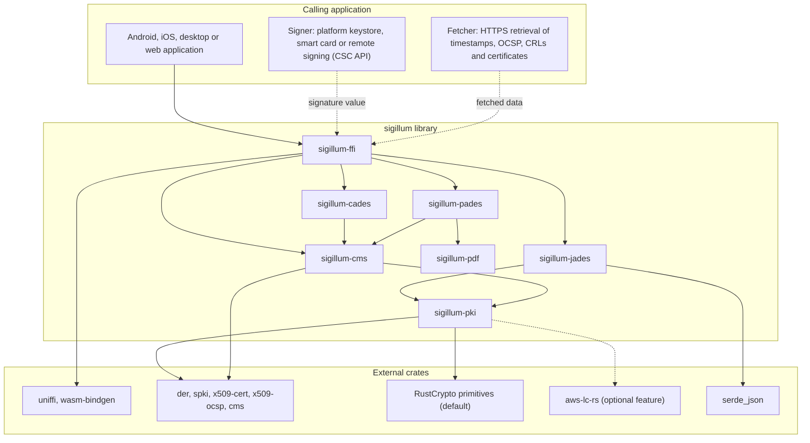
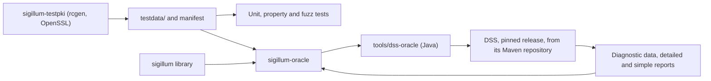

# Architecture

This document gives an overview of the workspace, its dependencies and its main design choices. The reasoning behind each significant decision is recorded in the [architecture decision records](adr/README.md).

## Workspace layout

| Component | Role | Published |
| --- | --- | --- |
| `sigillum-pki` | Cryptographic provider interface, certificates, path building and validation, OCSP, CRL, RFC 3161 timestamps, signer and fetcher interfaces | Yes |
| `sigillum-cms` | CMS SignedData and EnvelopedData construction and parsing, CAdES signed and unsigned attributes | Yes |
| `sigillum-pdf` | Minimal PDF reader, incremental-update writer, revision analysis (planned, [ADR-0015](adr/0015-pdf-reader-and-incremental-writer.md)) | Yes |
| `sigillum-cades` | CAdES profiles: BES, baseline B-B, B-T, B-LT | Yes |
| `sigillum-pades` | PAdES profiles: signature dictionary, document security store, appearance | Yes |
| `sigillum-jades` | JAdES profiles: JWS serialisations, ETSI header parameters, unsigned properties | Yes |
| `sigillum-ffi` | UniFFI bindings for Kotlin and Swift; `wasm-bindgen` bindings for JavaScript | Yes, from phase 1 |
| `sigillum-testpki` | Generator of the test PKI and corpus (planned, [ADR-0014](adr/0014-test-pki-and-corpus.md)) | No |
| `sigillum-oracle` | Differential test harness comparing sigillum with DSS | No |
| `tools/dss-oracle` | Java command-line tool that runs DSS for the harness (planned, [ADR-0013](adr/0013-dss-oracle-command-line-tool.md)) | No |

The crate names `sigillum` and `sigillum-core` on crates.io belong to an unrelated project; all crates of this project carry the `sigillum-` prefix followed by a functional name. An umbrella crate (`sigillum-ades`) may be added once the public API stabilises.

## Structure and dependencies

The library is layered. Format crates depend on the shared PKI and CMS layers and never on each other; only the binding layer sees all of them. Private keys and network access stay with the calling application.

The test tooling sits outside the library and is never a dependency of it.

## Design overview

| Topic | Choice | Record |
| --- | --- | --- |
| Implementation language and bindings | Rust; UniFFI for Kotlin and Swift; `wasm-bindgen` for JavaScript | [ADR-0002](adr/0002-implement-in-rust.md) |
| Licence and contributions | Apache-2.0 OR MIT; Developer Certificate of Origin | [ADR-0003](adr/0003-licence-and-contribution-terms.md) |
| Relationship with DSS | External test oracle only; no DSS code or test data | [ADR-0004](adr/0004-dss-as-test-oracle.md) |
| Signing flow | Two steps, `prepare` and `assemble`; keys stay with an external signer | [ADR-0005](adr/0005-two-step-signing.md) |
| Network access | None in the core; caller-supplied `Fetcher` | [ADR-0006](adr/0006-no-network-access-in-core.md) |
| Scope and unsupported input | Baseline-first creation; explicit "not supported" results | [ADR-0007](adr/0007-asymmetric-scope.md) |
| JAdES | Baseline B-B to B-LT in scope, after CAdES and PAdES | [ADR-0008](adr/0008-include-jades-baseline.md) |
| XAdES | Deferred; reviewed once the phase 3 XML component for trusted lists exists | [ADR-0009](adr/0009-keep-xades-deferred.md) |
| Cryptographic backend | RustCrypto by default behind a provider interface; `aws-lc-rs` as an optional feature; `rsa` for public-key operations only | [ADR-0010](adr/0010-cryptographic-backend.md) |
| ASN.1, X.509 and CMS | RustCrypto formats crates, not exposed in the public API | [ADR-0011](adr/0011-asn1-x509-cms-foundations.md) |
| Certificate path validation | Own implementation of RFC 5280 at an explicit validation time | [ADR-0012](adr/0012-certificate-path-validation.md) |
| DSS execution | Purpose-built Java command-line tool against a pinned DSS release | [ADR-0013](adr/0013-dss-oracle-command-line-tool.md) |
| Test PKI and corpus | Generated with tools independent of the code under test; committed with a manifest | [ADR-0014](adr/0014-test-pki-and-corpus.md) |
| PDF | Own minimal reader and append-only incremental writer | [ADR-0015](adr/0015-pdf-reader-and-incremental-writer.md) |
| JAdES implementation | Own implementation on `sigillum-pki`; duplicate header names rejected | [ADR-0016](adr/0016-jades-implementation-basis.md) |

### Errors, not panics

Malformed input never causes a panic. Every parser returns a typed error. `clippy::unwrap_used`, `clippy::expect_used` and `clippy::panic` are denied in library code.

### Memory safety

`unsafe` code is denied across the workspace, and every crate except `sigillum-ffi` forbids it outright with `#![forbid(unsafe_code)]`. Generated binding code in `sigillum-ffi` may require it.

### Minimum supported Rust version

Rust 1.85 (edition 2024). Raised only in a minor release, with notice in the changelog.
