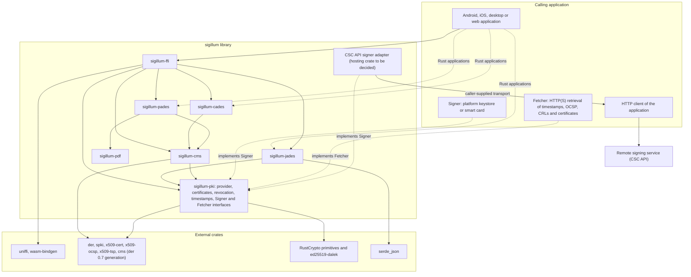
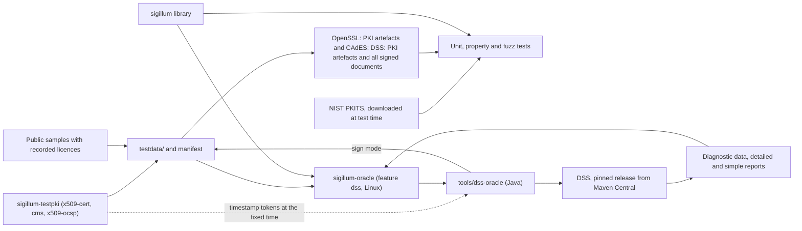

# Architecture

This document gives an overview of the workspace, its dependencies and its main design choices. The reasoning behind each significant decision is recorded in the [architecture decision records](adr/README.md).

## Workspace layout

| Component | Role | Published |
| --- | --- | --- |
| `sigillum-pki` | Cryptographic provider interface, certificates, path building and validation, OCSP, CRL, RFC 3161 timestamps, signer and fetcher interfaces | Yes |
| `sigillum-cms` | CMS SignedData, EnvelopedData and AuthEnvelopedData construction and parsing, CAdES signed and unsigned attributes | Yes |
| `sigillum-pdf` | Minimal PDF reader, append-only incremental-update writer, revision analysis (planned, [ADR-0015](adr/0015-pdf-reader-and-incremental-writer.md)) | Yes |
| `sigillum-cades` | CAdES profiles: BES, baseline B-B, B-T, B-LT | Yes |
| `sigillum-pades` | PAdES profiles: signature dictionary, document security store, visible appearance | Yes |
| `sigillum-jades` | JAdES profiles: JWS serialisations, ETSI header parameters, unsigned properties | Yes |
| `sigillum-ffi` | UniFFI bindings for Kotlin and Swift; `wasm-bindgen` bindings for JavaScript | Yes, from phase 1 |
| `sigillum-testpki` | Generator of the test PKI and corpus in Rust, verified by OpenSSL and DSS ([ADR-0014](adr/0014-test-pki-and-corpus.md)) | No |
| `sigillum-bench` | Benchmarks for goal G4 (placeholders until the first operations exist) | No |
| `sigillum-oracle` | Differential test harness comparing sigillum with DSS | No |
| `tools/dss-oracle` | Java command-line tool that runs DSS to validate and sign for the harness and the test PKI ([ADR-0013](adr/0013-dss-oracle-command-line-tool.md)) | No |

The crate names `sigillum` and `sigillum-core` on crates.io belong to an unrelated project; all crates of this project carry the `sigillum-` prefix followed by a functional name. An umbrella crate (`sigillum-ades`) may be added once the public API stabilises.

## Structure and dependencies

The library is layered. Format crates depend on the shared PKI, CMS and PDF layers and never on each other. Rust applications use the format crates directly; applications in other languages go through `sigillum-ffi`. Private keys stay with a signer and network access stays with the calling application.

The crate that hosts the CSC API signer adapter is open. It is decided when the CSC epic is planned in phase 1. The adapter reaches the remote signing service through a transport interface supplied by the caller, as [ADR-0006](adr/0006-no-network-access-in-core.md) requires.

The test tooling sits outside the library and is never a dependency of it.

`sigillum-oracle` depends on `sigillum-testpki` for the reader of the manifest and the runner of `tools/dss-oracle`. The reverse dependency cannot exist: `sigillum-testpki` depends on no sigillum crate, because they are the code under test ([ADR-0014](adr/0014-test-pki-and-corpus.md)), and `sigillum-oracle` will depend on the library to compare its results with those of DSS.

## Design overview

The security objectives, trust boundaries and threats that these choices address are described in the [threat model](threat-model.md).

| Topic | Choice | Record |
| --- | --- | --- |
| Implementation language and bindings | Rust; UniFFI for Kotlin and Swift; `wasm-bindgen` for JavaScript | [ADR-0002](adr/0002-implement-in-rust.md) |
| Licence and contributions | Apache-2.0 OR MIT; Developer Certificate of Origin | [ADR-0003](adr/0003-licence-and-contribution-terms.md) |
| Relationship with DSS | External test oracle only; no DSS code or test data | [ADR-0004](adr/0004-dss-as-test-oracle.md) |
| Divergences from DSS | Three classes: required or permitted by the standard, DSS defects, intentional restrictions decided in an ADR; Ed25519 public keys of small order restricted | [ADR-0019](adr/0019-divergence-classes-and-intentional-restrictions.md) |
| Signing flow | Two steps, `prepare` and `assemble`; keys stay with an external signer | [ADR-0005](adr/0005-two-step-signing.md) |
| Network access | None in the core; caller-supplied `Fetcher` | [ADR-0006](adr/0006-no-network-access-in-core.md) |
| Scope and unsupported input | Baseline-first creation; explicit "not supported" results | [ADR-0007](adr/0007-asymmetric-scope.md) |
| JAdES | Baseline B-B to B-LT in scope, after CAdES and PAdES | [ADR-0008](adr/0008-include-jades-baseline.md) |
| JAdES payloads and detached mechanisms | Unencoded payloads and `HttpHeaders` excluded; `ObjectIdByURI` with one object only | [ADR-0018](adr/0018-restrict-jades-payloads-and-detached-mechanisms.md) |
| XAdES | Deferred; reviewed once the phase 3 XML component for trusted lists exists | [ADR-0009](adr/0009-keep-xades-deferred.md) |
| Cryptographic backend | RustCrypto behind a provider interface; `rsa` for public-key operations only, enforced by lint | [ADR-0010](adr/0010-cryptographic-backend.md) |
| ASN.1, X.509 and CMS | RustCrypto formats crates, stable `der` 0.7 generation, not exposed in the public API | [ADR-0011](adr/0011-asn1-x509-cms-foundations.md) |
| Untrusted input | Caller-configurable size limits; DER length walk in `sigillum-pki` before decoding; untrusted object identifiers checked before parsing, with arcs below 2^28 (DIV-2); fuzz target per entry point | [ADR-0024](adr/0024-bounded-decoding-of-untrusted-input.md) |
| Accepted advisories | RUSTSEC-2023-0071 and RUSTSEC-2026-0387, public data and test keys only; no elliptic-curve operation on secret values before the der 0.8 migration | [ADR-0020](adr/0020-accepted-advisories-der-0-7.md) |
| Certificate path validation | Own implementation of RFC 5280 at an explicit validation time, with results in AdES terms | [ADR-0012](adr/0012-certificate-path-validation.md) |
| DSS execution | Purpose-built Java command-line tool against a pinned DSS release; Linux-only job | [ADR-0013](adr/0013-dss-oracle-command-line-tool.md) |
| Test PKI and corpus | PKI artefacts generated in Rust, signed documents by DSS; checked by OpenSSL and DSS in CI; committed with a manifest | [ADR-0014](adr/0014-test-pki-and-corpus.md) |
| PDF | Own minimal reader and append-only incremental writer | [ADR-0015](adr/0015-pdf-reader-and-incremental-writer.md) |
| JAdES implementation | Own implementation on `sigillum-pki`; duplicate header names rejected | [ADR-0016](adr/0016-jades-implementation-basis.md) |
| Defensive API rules | Verify after signing; re-supplied document; restricted and bounded fetcher; explicit valid outcome with conformance findings; DocMDP respected; evidence checked before embedding; no B-LT on a revoked certificate | [ADR-0017](adr/0017-defensive-api-rules.md) |

### Errors, not panics

Malformed input never causes a panic. Every parser returns a typed error. `clippy::unwrap_used`, `clippy::expect_used` and `clippy::panic` are denied in library code.

### Memory safety

`unsafe` code is denied across the workspace, and every crate except `sigillum-ffi` forbids it outright with `#![forbid(unsafe_code)]`. Generated binding code in `sigillum-ffi` may require it.

### Minimum supported Rust version

Rust 1.88 (edition 2024). Raised only in a minor release, with notice in the changelog.
