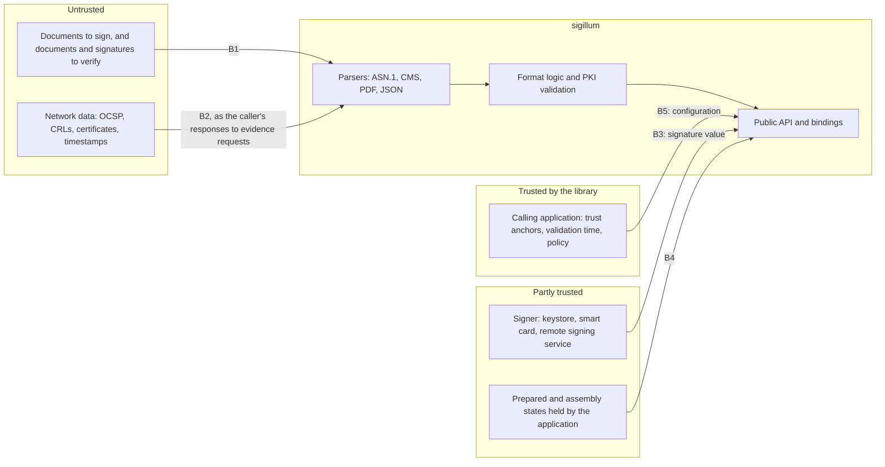

# Threat model

This document states what sigillum protects, against whom, and how. Each threat names the mechanism that addresses it and the evidence that the mechanism works: a test, a fuzz target, a design rule, or an open issue. It is reviewed at the end of every phase and whenever a new format, interface or dependency class is added.

## Security objectives

| Id | Objective |
| --- | --- |
| O1 | **No false acceptance.** Verification never reports a signature as valid unless the content, the signer and the time evidence it reports are authentic and bound to the signature. |
| O2 | **What is passed is what is signed.** Signature creation produces a signature over exactly the document and attributes the caller supplied, with the certificate the caller supplied. |
| O3 | **Safe on hostile input.** Parsing any input cannot corrupt memory, panic, or consume unbounded memory or time. |
| O4 | **Honest results.** Anything the library does not check is reported as not checked, never as passed ([ADR-0007](adr/0007-asymmetric-scope.md)). |
| O5 | **No leakage.** Private keys never enter the library ([ADR-0005](adr/0005-two-step-signing.md)); errors never contain document content or secret material. The library does not log; applications decide what to record. |
| O6 | **Trustworthy releases.** What users install is what the repository contains, built from reviewed code and dependencies. |

### Outside the model

- The security of the device, the operating system and the calling application, including an attacker with code execution in the application's process.
- The caller's trust configuration: the trust anchors, the validation time and the policy are inputs the library trusts.
- The security of signature creation devices and remote signing services, and the authentication of the signer to them. Within the model, a signer is only assumed able to return a wrong value (attacker A6, threat G2). A compromised signer that also signs data of the attacker's choice with the right key is outside it.
- A trust service provider whose keys are valid but whose service is compromised. Examples are a certification authority issuing certificates to an impostor, or a timestamping authority issuing false times. The library verifies what the trust anchors attest; it cannot detect a trusted party that lies.
- Presentation to the user: showing the user exactly what is signed, and the signed revision of a PDF, is the application's responsibility. The library supplies the information needed to do it (threat R2).
- Side channels in cryptographic primitives beyond what [ADR-0010](adr/0010-cryptographic-backend.md) states.
- The security of the test tooling (`sigillum-testpki`, `sigillum-oracle`, `tools/dss-oracle`), which is never shipped.

## System and trust boundaries

Boundary B6, the supply chain, is not drawn. It is described in the table below and in the section *Supply chain and releases*.

| Boundary | What crosses it | Trust |
| --- | --- | --- |
| B1 | Documents to sign and to verify, CMS structures, JWS, embedded certificates, CRLs, OCSP responses and timestamp tokens | None. Every byte may be crafted, including a document that another party asks the user to sign. |
| B2 | Responses that the caller returns to the library's evidence requests, retrieved directly or through a `Fetcher` ([ADR-0026](adr/0026-public-api-conventions.md), decision 2) | None, even over TLS. Fetched data is trusted only through its own signatures. |
| B3 | Signature values and certificates returned by the signer | Partial. A remote service or a faulty token may return a wrong value. |
| B4 | The states serialised between the steps: the prepared state between `prepare` and `assemble`, and the assembly state between `assemble` and `resume` and between rounds of `resume` ([ADR-0026](adr/0026-public-api-conventions.md), decision 6) | Partial. They are stored by the application, where they may be altered. The library never treats them as authoritative: nothing signed is taken from them, and evidence kept in them is validated again ([ADR-0026](adr/0026-public-api-conventions.md), decision 6). |
| B5 | Trust anchors, validation time, policy, the choice of what to sign, and the recipients to encrypt for | Trusted, but the API must make misuse hard. |
| B6 | Dependencies, build and release pipeline | Trusted only after review and verification (threats S1 to S6). |

## Attackers

| Id | Capability | Example |
| --- | --- | --- |
| A1 | Crafts any document, signature or PKI artefact the library will read | Sends a manipulated PDF or `.p7m` to a recipient who verifies it |
| A2 | Controls the data the fetcher returns | Network attacker, compromised responder, or malicious URL in a certificate |
| A3 | Holds a valid certificate under a trusted anchor | A real signer who wants a signature to appear to cover other content, or another time |
| A4 | Can modify the application's stored states between the steps of signing | Malware with storage access but without process control |
| A5 | Compromises a dependency, a build tool or the release path | Malicious crate update |
| A6 | Operates or compromises a signer or remote signing service used by the caller | A faulty token, or a remote service that returns a value made with another key |

## Threats and mitigations

Evidence column: *fuzz* means a fuzz target required by the quality gates; *fixture* means a corpus artefact with an expected result checked by DSS, and also by OpenSSL where OpenSSL supports the format ([ADR-0014](adr/0014-test-pki-and-corpus.md)); *phase N* means the stories of that phase must include the test.

### Parsing (all formats)

| Id | Threat | Mitigation | Evidence |
| --- | --- | --- | --- |
| P1 | A1 corrupts memory through malformed input | Rust, `unsafe` forbidden outside the binding layer ([ADR-0002](adr/0002-implement-in-rust.md)) | Lint configuration; fuzz |
| P2 | A1 exhausts memory or time: deep nesting of ASN.1, PDF or JSON; huge declared lengths; cycles in PDF references or `/Prev` chains; decompression bombs in PDF streams | Explicit limits on nesting depth, declared and decompressed sizes, object count and revision count; cycle detection; limits documented and configurable within safe maxima. Every public decoding entry point has an input size limit. For DER, a length walk precedes any allocating decode ([ADR-0024](adr/0024-bounded-decoding-of-untrusted-input.md)) | Fuzz with memory and time limits, with a target for every public decoding entry point; unit tests at each limit |
| P3 | A1 exploits a parser differential: two components, or sigillum and other verifiers, read different content from the same bytes (BER instead of DER, duplicate JSON members, lenient PDF repair) | DER required where the standards require it, with re-encoding checks on signed attributes; duplicate JOSE header names rejected ([ADR-0016](adr/0016-jades-implementation-basis.md)); no repair mode in verification | Fixtures; differential tests against DSS |
| P4 | A1 triggers a panic | Typed errors; `unwrap`, `expect` and `panic` denied in library code. Panics from indexing or arithmetic overflow are not caught by these lints | Lint configuration; fuzz, which is the only evidence for indexing and overflow |

### CMS and CAdES

| Id | Threat | Mitigation | Evidence |
| --- | --- | --- | --- |
| C1 | A1 alters content while the signature still verifies, because the message-digest or content-type attribute is not checked | Both attributes required and checked against the content and `eContentType` (RFC 5652, sections 5.3, 5.6, 11.1 and 11.2) | Fixture with the content changed and the signed attributes intact, `mutations/cades-modified-content` (#32) |
| C2 | A1 or A3 substitutes the signing certificate with another one carrying the same key | ESS `signingCertificateV2` required and matched against the certificate used ([ETSI EN 319 122-1 V1.3.1](https://www.etsi.org/deliver/etsi_en/319100_319199/31912201/01.03.01_60/en_31912201v010301p.pdf), clause 5.2.2.3) | Fixture; phase 2 |
| C3 | A1 downgrades the algorithm, or uses a weak one | Algorithm identifiers checked for consistency; cryptographic policy rejects weak algorithms (scope.md) | Fixtures with SHA-1 and MD5; phase 2 |
| C4 | A1 strips or injects unsigned attributes, such as a signature timestamp, to change the apparent level | Each unsigned attribute validated on its own; the level reported is the level observed, never assumed | Fixtures with removed and foreign timestamps; phase 2 |
| C5 | Detached content is confused with other content | Detached content is an explicit input; its digest is compared; a missing content yields an error | Unit tests; phase 1 |

### CMS EnvelopedData and AuthEnvelopedData

| Id | Threat | Mitigation | Evidence |
| --- | --- | --- | --- |
| E1 | Weak or predictable content-encryption keys, or repeated IVs and nonces | Keys, IVs and nonces generated from the operating system's random source through `getrandom`. On `wasm32` the host's Web Crypto random source is required and its absence is an error, never a fallback | Unit tests; target check in CI; phase 1 |
| E2 | Content encrypted without integrity protection, so that ciphertext can be altered | Authenticated encryption is the default: `AuthEnvelopedData` with AES-GCM ([RFC 5083](https://www.rfc-editor.org/rfc/rfc5083), [RFC 5084](https://www.rfc-editor.org/rfc/rfc5084)). AES-CBC in `EnvelopedData` is offered only where a receiving system requires it, documented as giving no integrity | Unit tests; phase 1 |
| E3 | The recipient certificate is substituted, so that content is encrypted for the attacker | The caller supplies recipient certificates; the library checks their key usage and validity at the encryption time, and reports the recipients it encrypted for. Which recipients to trust is the caller's decision (B5) | Unit tests; phase 1 |
| E4 | Recipient key transport with RSA PKCS#1 v1.5, open to padding-oracle attacks on decryption | RSA-OAEP is the default; PKCS#1 v1.5 key transport is offered for compatibility only and documented; decryption is not performed by the library ([ADR-0010](adr/0010-cryptographic-backend.md)) | Unit tests; phase 1 |

### PDF and PAdES

The attack classes below are documented in *1 Trillion Dollar Refund: How To Spoof PDF Signatures* (ACM CCS 2019) and *Shadow Attacks: Hiding and Replacing Content in Signed PDFs* (NDSS 2021). Attacks on certification signatures are documented in *Breaking the Specification: PDF Certification* (IEEE S&P 2021).

| Id | Threat | Mitigation | Evidence |
| --- | --- | --- | --- |
| D1 | Incremental saving attack: A1 or A3 appends content after signing | Revision analysis reports every change after each signature; only changes permitted for validation data, document timestamps and by the document's permissions are accepted ([ADR-0015](adr/0015-pdf-reader-and-incremental-writer.md)) | Fixture (#112); phase 2 |
| D2 | Shadow attacks of the hide, replace and hide-and-replace classes: A1 or A3 prepares content in the signed revision that is hidden or replaced through a later permitted change | Object-level analysis of later revisions: changes to objects reachable from page content, annotations or form appearances after signing are reported | One fixture per class (#112); phase 2. Residual risk: variants detectable only by rendering (excluded by scope.md) |
| D3 | Signature wrapping: A1 manipulates `ByteRange` so that signed bytes are moved or `/Contents` is placed elsewhere | `ByteRange` must start at 0, exclude exactly the `/Contents` string of the same signature dictionary, and end at the end of that revision | Fixture with partial `ByteRange` (#112); fuzz |
| D4 | Universal signature forgery: missing, empty or malformed `/Contents`, `/ByteRange` or `/Filter` values | Strict structural validation; any malformed value yields failure, never a pass | Fixtures; fuzz |
| D5 | A3 abuses certification permissions (DocMDP) | DocMDP permissions evaluated; changes beyond them give failure, as detailed in D13 | Phase 2 |
| D6 | A1 creates inconsistent structure: an object number defined twice with different content in the same revision, cross-reference streams and tables that disagree in a hybrid file, or `/Prev` loops | Hybrid cross-reference files are allowed (ISO 32000-1:2008, clause 7.5.8.4); only inconsistent ones are rejected. Strict, linear revision chain; cycles rejected | Fuzz; phase 1 |
| D7 | Encrypted PDF documents | Not supported (scope.md): signing is refused with a typed error; verification reports INDETERMINATE with "not supported" | Unit test; phase 1. Fixture; phase 2 |
| D8 | Signing writes content the caller did not supply | Append-only writer; appearance built only from caller-supplied text and image; no scripts or actions written | Phase 1 |
| D9 | Legacy or unexpected `/SubFilter` values (`adbe.pkcs7.sha1`, `adbe.x509.rsa_sha1`) are processed under rules other than those of the supported values | Signature dictionaries accept only `ETSI.CAdES.detached` and `adbe.pkcs7.detached`. `ETSI.RFC3161` is accepted only in `/DocTimeStamp` dictionaries. Other values give INDETERMINATE with "not supported". On verification, document timestamps count as time evidence at B-T and B-LT (ETSI EN 319 142-1 V1.2.1, clause 6.3, item n). Only their use for archive renewal is deferred with B-LTA | Fixtures; phase 2 |
| D10 | Data after the CMS structure inside `/Contents` is ignored by some verifiers and used by others | Only zero padding is allowed after the DER encoding of the CMS structure; anything else is a failure. ISO 32000-1:2008, clauses 12.8.3.3.1 and 12.8.3.3.2, requires a DER-encoded PKCS#7 object padded with zeros. The DER length of the `ContentInfo` (RFC 5652, section 3) marks where it ends | Fixture; fuzz |
| D11 | `ByteRange` with more or fewer than four integers, negative or overlapping ranges | Exactly four non-negative integers describing two ranges, in order, without overlap; otherwise failure. Complements D3 and D4 | Fixtures; fuzz |
| D12 | Signing a document whose certification signature forbids further changes | `prepare` reads the DocMDP permissions and refuses to add a signature that they forbid ([ADR-0017](adr/0017-defensive-api-rules.md), rule 5) | Unit tests; phase 1 |
| D13 | Certification attacks on DocMDP permissions (D5), as described in *Breaking the Specification: PDF Certification* | Changes after a certification signature are classified against its permissions, including annotation and form changes; disallowed changes give failure | Fixtures; phase 2 |

### JAdES

| Id | Threat | Mitigation | Evidence |
| --- | --- | --- | --- |
| J1 | Duplicate protected header parameters read differently by different verifiers | Rejected ([ADR-0016](adr/0016-jades-implementation-basis.md)), as RFC 7515, section 4, permits | Fixture `mutations/jades-duplicate-header-parameter`, whose signature value is also broken, so a test of the duplicate check also needs a signature that verifies |
| J2 | Algorithm confusion: `alg` set to `none`, to an HMAC algorithm, or to one inconsistent with the key ([RFC 8725](https://www.rfc-editor.org/rfc/rfc8725), sections 2.1 and 3.1) | Allow list of asymmetric algorithms per key type; `none` and HMAC always rejected | Fixtures; phase 1 |
| J3 | Unknown critical header parameters ignored | Any name in `crit` that the library does not process causes rejection (RFC 7515, section 4.1.11) | Fixture; phase 1 |
| J4 | Certificate selection: `x5c` and the signing-certificate reference disagree, or `kid` alone selects a key | A signed reference to the signing certificate (`x5t#S256`, `x5t#o`, `sigX5ts` or a signed `x5c`, TS 119 182-1 V1.2.1, clause 5.1.7) is required and must match the certificate used. Creation always includes `x5c` (Commission Implementing Regulation (EU) 2026/248 of 2 February 2026, Annex I, [ELI](http://data.europa.eu/eli/reg_impl/2026/248/oj)). Annex I allows `x5c` as a signed or unsigned header parameter, so an unsigned `x5c` is acceptable when a signed reference is present. Verification does not reject a signature without `x5c`. It proceeds when the signing certificate is available from `x5c` or from the caller. The indication follows EN 319 102-1 V1.4.1 and may be TOTAL-PASSED; the missing `x5c` is reported as a conformance finding ([ADR-0017](adr/0017-defensive-api-rules.md), rule 4). Without the signing certificate, the result is INDETERMINATE with NO_SIGNING_CERTIFICATE_FOUND (ETSI EN 319 102-1 V1.4.1, clause 5.2.3) | Fixtures; phase 1 |
| J5 | Detached content substituted through `sigD`. Under `ObjectIdByURI`, the boundary between objects can be shifted, because their encodings are concatenated without separators (TS 119 182-1 V1.2.1, clause 5.2.8.3.2) | `ObjectIdByURI` with a single object only; `ObjectIdByURIHash`, which signs a digest of each object, for more than one; digests checked. `HttpHeaders` excluded. Other cases are reported as not supported ([ADR-0018](adr/0018-restrict-jades-payloads-and-detached-mechanisms.md)) | Fixtures, including an adversarial fixture with two objects whose boundary is shifted; phase 1 |
| J6 | Unencoded payloads (`b64` set to false, RFC 7797) create ambiguity | Not supported in creation or verification ([ADR-0018](adr/0018-restrict-jades-payloads-and-detached-mechanisms.md)); verification reports INDETERMINATE with "not supported" | Fixture; phase 1 |
| J7 | Non-canonical base64url (padding, line breaks, non-zero trailing bits) lets two implementations decode different values | Only canonical unpadded base64url is accepted. RFC 7515, section 2, defines base64url without padding or line breaks; [RFC 4648](https://www.rfc-editor.org/rfc/rfc4648), section 3.5, lets a decoder reject non-zero pad bits | Unit tests; fuzz |

### Certificates, revocation and time

| Id | Threat | Mitigation | Evidence |
| --- | --- | --- | --- |
| K1 | A1 or A2 introduces a new trust anchor through embedded or fetched certificates | Trust anchors come only from the caller; embedded and fetched certificates serve only as candidate intermediates and are fully validated ([ADR-0012](adr/0012-certificate-path-validation.md)) | Fixtures; phase 1 |
| K2 | A2 replays an old "good" OCSP response, or supplies a CRL or OCSP response from the wrong issuer or an unauthorised responder | Issuer and responder authorisation checked ([RFC 6960](https://www.rfc-editor.org/rfc/rfc6960), section 4.2.2.2); freshness assessed against the time of interest; embedded data validated exactly like fetched data | Fixtures (#28, #29); phase 1 |
| K3 | A self-asserted signing time is taken as proof of time | The signing-time attribute is never treated as evidence; only timestamp tokens provide proof of existence; the validation time is an explicit input | Unit tests; phase 2 |
| K4 | Timestamp substitution: a token over other data, or from a TSA without the timestamping key purpose | Message imprint checked against the signature value; critical `id-kp-timeStamping` required (RFC 3161, section 2.3); TSA chain validated. A document timestamp has its imprint checked over its own `ByteRange`, and D3 applies to its dictionary. It counts as time evidence for a signature only if its `ByteRange` covers the revision that contains that signature | Fixtures (#30); phase 1 |
| K5 | A3 back-dates a signature made with a key revoked later | Without proof of existence before revocation, the result is INDETERMINATE with REVOKED_NO_POE, as ETSI EN 319 102-1 V1.4.1, clause 5.2.6, requires | Fixture with a key revoked after signing (#28); phase 2 |
| K6 | Weak algorithms in the certificate chain | Cryptographic policy applied to every certificate and revocation token, with algorithm expiry dates. SHA-1 used only as a lookup identifier is exempt (K10) | Phase 2 |
| K7 | Path features the library does not implement (explicit policy processing) | "Not supported" results ([ADR-0012](adr/0012-certificate-path-validation.md)) | Unit tests; phase 1 |
| K8 | A certificate carries an unknown critical extension | The path is invalid ([RFC 5280](https://www.rfc-editor.org/rfc/rfc5280), section 4.2), except for the extensions handled under K7 | Fixture (#27) |
| K9 | Invalid elliptic-curve points, non-canonical Ed25519 signatures, or Ed25519 public keys of small order, accepted by lenient verification | Points validated on decoding. A non-canonical Ed25519 signature, including S out of range, is invalid ([RFC 8032](https://www.rfc-editor.org/rfc/rfc8032), sections 5.1.3 and 5.1.7). A public key of small order is detected before verification and yields INDETERMINATE with "not supported" ([ADR-0019](adr/0019-divergence-classes-and-intentional-restrictions.md)) | Unit tests with published vectors and a small-order key; phase 1. Differences from DSS are recorded in `divergences.md` under their class |
| K10 | An OCSP response whose `CertID` does not match the certificate in question is used as its status | `CertID` hash algorithm, issuer name hash, issuer key hash and serial number are all checked; a mismatch makes the response inapplicable (RFC 6960, sections 3.2 and 4.1.1). The issuer name hash and issuer key hash, computed with that algorithm, only identify the issuer. They are lookup identifiers, not signatures. SHA-1 is accepted for them, despite the cryptographic policy, where a standard specifies or permits SHA-1 for that identifier (scope.md). The same holds for the `byKey` responder identifier (RFC 6960, sections 4.2.1 and 4.2.2.3). It also holds for key identifiers computed with method 1 of RFC 5280, section 4.2.1.2. SHA-1 is never accepted for integrity or signatures. The authenticity of the response rests on its signature and on the authorisation of its responder (K2) | Fixtures (#29) for a wrong issuer name hash and a wrong issuer key hash. A fixture with a SHA-256 `CertID` will be added for the hash algorithm |
| K11 | A2 supplies, beside a CRL that shows the certificate not revoked, an OCSP response for it that is not acceptable, such as one with a broken signature, a signer whose certificate cannot be validated, the status unknown or an unauthorised responder, so that a verifier that keeps the first source covering the certificate cannot conclude | Revocation selection: each CRL and OCSP response is validated on its own, and one that is not acceptable is set aside. Another acceptable source that covers the certificate is then used if one exists, the latest issued that is known to contain status information about it (ETSI EN 319 102-1 V1.4.1, clause 5.2.6.4, step 4). DSS 6.5.1 does not fall back to the CRL when the response gives the status unknown or its signer cannot be validated (DIV-4 in [divergences.md](divergences.md)) | Corpus fixtures `ocsp/unknown` and `crl/ca-ecdsa`, and variants of `ocsp/signer-p256` with an altered responder certificate or an altered response signature (`ValidateCertificateTest`); phase 1 |

### Signing flow and signer interface

| Id | Threat | Mitigation | Evidence |
| --- | --- | --- | --- |
| G1 | A4 alters the prepared state, or alters or swaps the assembly state, so that the user signs data for another document or receives a signature over another document or by another signer | No state is authoritative. `assemble` and `resume` receive the document, the signer chain, the options and the signing time again, recompute everything that is signed from them, and accept the signature value only if it verifies over the recomputed data with the key of the re-supplied signing certificate. A change of the options, the signer chain or the supplied evidence for signed elements is refused first by the early consistency check with `StateMismatch`; any other change that alters what is signed or the signer ends in `SignatureMismatch`. The chain is validated again at every call. Replacing kept evidence with other valid evidence is accepted, and harmless ([ADR-0017](adr/0017-defensive-api-rules.md), rules 1 and 2; [ADR-0026](adr/0026-public-api-conventions.md), decision 6) | Unit tests; phase 1 |
| G2 | A6 returns a value from another key, or a malformed value | `assemble` verifies the signature value against the data to be signed and the certificate's public key before producing output, and fails otherwise. `resume` verifies the value kept in the assembly state again, at every call, against the data recomputed from the re-supplied inputs, before it issues a request or returns the signed object ([ADR-0017](adr/0017-defensive-api-rules.md), rule 1; [ADR-0026](adr/0026-public-api-conventions.md), decision 6) | Unit tests; phase 1 |
| G3 | The caller requests a weak or out-of-scope algorithm or level | Creation refuses with a typed "not supported" error | Unit tests; phase 1 |
| G4 | Signing with a certificate whose key usage does not allow it | `prepare`, `assemble` and `resume` each check the key usage of the re-supplied signing certificate and report a typed error ([ADR-0026](adr/0026-public-api-conventions.md), decision 1) | Fixture without `nonRepudiation` (#27); phase 1 |
| G5 | A2 supplies a timestamp token that does not cover the signature value, comes from an unexpected TSA or carries a wrong nonce | Before embedding, `assemble` or `resume`, whichever receives the token, checks it as in K4: the message imprint against the signature value, the critical `id-kp-timeStamping` purpose and the TSA chain to a caller-supplied anchor. It also checks the nonce when the state records one. Whether a nonce was sent is known only from the state, which is not trusted, so the nonce check cannot detect a replayed token whose nonce was removed or replaced in the state; the message imprint, the purpose and the TSA chain are still checked, and, independently of the state, the `genTime` of a signature timestamp, widened by its stated accuracy, must not precede the signing time supplied by the caller. Any failure is an error ([ADR-0017](adr/0017-defensive-api-rules.md), rule 6; [ADR-0026](adr/0026-public-api-conventions.md), decision 6) | Fixtures (#30); phase 1 |
| G6 | A2 supplies revocation data that is forged, stale or for another certificate, which B-LT would embed as evidence | Revocation data is validated exactly as in verification (K2, K10) by `assemble` or `resume`, whichever receives it, before it is embedded ([ADR-0017](adr/0017-defensive-api-rules.md), rule 6) | Fixtures (#28, #29); phase 1 |
| G7 | The signing certificate is already revoked, or its status is unknown, when signing at B-LT | `assemble` and `resume` refuse to produce B-LT with a revoked certificate, and report an unknown status as an error unless the caller explicitly accepts a lower level ([ADR-0017](adr/0017-defensive-api-rules.md), rule 7). An OCSP nonce removed or replaced in the state lets a replayed "good" response pass the nonce check; the other checks of rule 6, including those of `thisUpdate` and `nextUpdate`, still apply ([ADR-0026](adr/0026-public-api-conventions.md), decision 6) | Fixtures; phase 1 |

### Fetcher

| Id | Threat | Mitigation | Evidence |
| --- | --- | --- | --- |
| F1 | A2 returns oversized or malformed data | Each evidence request carries a maximum response size, so that the caller, or its fetcher, can stop reading early ([ADR-0026](adr/0026-public-api-conventions.md), decision 2). The library rejects larger responses ([ADR-0017](adr/0017-defensive-api-rules.md), rule 8). The same hardened parsers; fetched data trusted only through its signatures | Fuzz; phase 1 |
| F2 | A1 places URLs in certificates (AIA, CRL distribution points, OCSP) that make the caller, or its fetcher, reach internal or unexpected addresses | The core never fetches ([ADR-0006](adr/0006-no-network-access-in-core.md)); each request states the URL and the extension it came from; only `http` and `https` URLs are placed in evidence requests, and the number of requests is bounded for each call, and across calls while the caller passes the state on unchanged, with the caller or the driver keeping the budget ([ADR-0026](adr/0026-public-api-conventions.md), decision 2; [ADR-0017](adr/0017-defensive-api-rules.md), rule 3) | Unit tests; phase 1 |
| F3 | Revocation requests reveal to responders which signatures are being verified | The caller performs the requests, or decides not to, and can work offline with embedded data | Documentation |

### Results and bindings

| Id | Threat | Mitigation | Evidence |
| --- | --- | --- | --- |
| R1 | The application treats an INDETERMINATE or partial result as valid | Only TOTAL-PASSED is exposed as a valid outcome; every other indication is a distinct type the caller must handle ([ADR-0017](adr/0017-defensive-api-rules.md), rule 4) | API review; phase 2 |
| R2 | The result describes a different object from the one the application shows, such as a PDF revision | Results identify the signed revision and its byte range, so the application can display the signed version | Phase 2 |
| R3 | Error messages leak document content | Errors carry positions and types, never content | Review checklist; unit tests |
| R4 | Defects in generated binding code | `unsafe` confined to `sigillum-ffi`; binding tests on every platform in CI | Phase 1 |
| R5 | In WebAssembly, documents remain in JavaScript memory beyond the caller's control | Documented; keys are never handled in WebAssembly, the signer stays external | Documentation |

### Supply chain and releases

| Id | Threat | Mitigation | Evidence |
| --- | --- | --- | --- |
| S1 | A5 publishes a malicious dependency update | `cargo deny`; `cargo vet` (#5); grouped and reviewed Dependabot updates; required checks | CI |
| S2 | A5 tampers with CI | Actions pinned by hash; least-privilege workflow permissions; OpenSSF Scorecard. The one path by which CI writes the contents of the repository is the job *Save the corpus* of `fuzz-nightly.yml`, which pushes the branch `fuzz-corpus` with the `GITHUB_TOKEN` of the run, runs no code of the repository and runs only for `main`; a ruleset restricts that branch, as [quality-gates.md](../development/quality-gates.md#nightly-fuzzing) describes. A corpus altered there can only change which inputs are fuzzed | CI; Scorecard; ruleset |
| S3 | Unauthorised change reaches `main` | Pull requests required; signed commits verified; bypass limited to pull requests | Ruleset |
| S4 | Release artefacts differ from the repository | Trusted publishing to crates.io, signed tags and an SBOM per release (#7); build provenance attestations to be considered | #7 |
| S5 | Users install the unrelated `sigillum` or `sigillum-core` crates by mistake | The README and crate documentation state the crate names; every published crate carries the `sigillum-` prefix with a functional name | Documentation |
| S6 | The maintainer's account or signing key is compromised | Hardware-backed second factor on the GitHub account, which is also the crates.io login; no long-lived crates.io API tokens after the first release of each crate, through trusted publishing (S4). The token for a first release is scoped and revoked after use. Signed commits are verified in CI. The ruleset does not bind a compromised administrator account | Ruleset; residual risk 7 |

## Residual risks

1. Shadow-attack variants that can only be detected by rendering the document.
2. Differences between what a PDF viewer displays and what the document structure contains, for example through fonts or optional content.
3. A defect shared by sigillum, OpenSSL and DSS, which the conformance strategy cannot detect ([ADR-0014](adr/0014-test-pki-and-corpus.md)).
4. Errors in the caller's trust configuration.
5. An attacker who alters the document before `prepare` is called, so that what the application presents to the user is not what is signed, or who makes a consistent alteration of all stored inputs, the document, the chain, the options, the signing time, the supplied evidence for signed elements and the state, before signing or before `resume`. The library signs what it receives and cannot detect either. Any other change after `prepare` that alters what is signed or the signer, made to some of the inputs or to a stored state, ends in an error, because everything signed is recomputed and the signature value must verify over it ([ADR-0026](adr/0026-public-api-conventions.md), decision 6).
6. A compromised trust service whose keys remain valid (see *Outside the model*).
7. Compromise of the single maintainer's account or signing key (threat S6).
8. A replayed timestamp token over the same signature value, or a replayed OCSP response, accepted because the nonce recorded in an altered state was removed or replaced (threats G5 and G7). The other checks of the token or response still apply, including the `genTime` of a signature timestamp against the signing time and the `thisUpdate` and `nextUpdate` of an OCSP response ([ADR-0026](adr/0026-public-api-conventions.md), decision 6).
9. Findings of the nightly fuzzing are public until they are removed: the log of a failing run, with its stack trace, and the failing input, kept as an artefact for 7 days, can be read by anyone, because the repository is public. The corpus of a target with a finding is not saved that night, so neither the failing input nor inputs derived from it enter the history of the corpus branch. A finding is then handled through a private security advisory ([quality-gates.md](../development/quality-gates.md#nightly-fuzzing)).

## Decisions

[ADR-0017](adr/0017-defensive-api-rules.md) records the rules that shape the public API in response to threats G1, G2, F2, R1, D12, G5, G6, G7 and F1. It also records the conformance findings of J4. The exclusion of unencoded JAdES payloads and of the `HttpHeaders` mechanism, and the restriction of `ObjectIdByURI` to one object (J5, J6), are recorded in [ADR-0018](adr/0018-restrict-jades-payloads-and-detached-mechanisms.md). [ADR-0026](adr/0026-public-api-conventions.md) records the request and response loop through which evidence crosses boundary B2 (F1, F2), and the state model, in which no state is authoritative and every signed element is recomputed from re-supplied inputs and bound by verifying the signature value (G1, G2, B4). The rules for decoding untrusted input (P2) are recorded in [ADR-0024](adr/0024-bounded-decoding-of-untrusted-input.md). The exclusion of encrypted PDF documents (D7) and the default to authenticated encryption (E2) are recorded in [scope.md](../project/scope.md).

## References

- ETSI EN 319 102-1 V1.4.1, procedures for creation and validation of AdES digital signatures.
- ETSI EN 319 122-1 V1.3.1, EN 319 142-1 V1.2.1 and TS 119 182-1 V1.2.1, the baseline signature formats.
- RFC 5652 (CMS), RFC 5083 and RFC 5084 (authenticated CMS encryption), RFC 3161 (timestamps), RFC 5280 (certificates and CRLs), RFC 6960 (OCSP), RFC 7515 and RFC 7797 (JWS), RFC 4648 (base64url), RFC 8725 (JWT best current practice).
- ISO 32000-1:2008, the PDF 1.7 specification.
- V. Mladenov, C. Mainka, K. Meyer zu Selhausen, M. Grothe, J. Schwenk, *1 Trillion Dollar Refund: How To Spoof PDF Signatures*, ACM CCS 2019.
- C. Mainka, V. Mladenov, S. Rohlmann, *Shadow Attacks: Hiding and Replacing Content in Signed PDFs*, NDSS 2021.
- S. Rohlmann, V. Mladenov, C. Mainka, J. Schwenk, *Breaking the Specification: PDF Certification*, IEEE S&P 2021.
